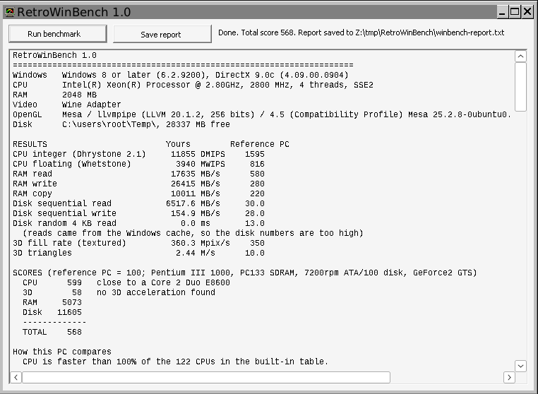

# RetroWinBench

A small benchmark for Windows 98 and Windows XP PCs. It tests the CPU, RAM,
disk and 3D card, sums them up in one score, compares that score with
hardware from 1997 to 2008, and lists which classic games the PC can run.

One 58 KB .exe. No installer, no internet, no extra DLLs. It runs on any
CPU from a 486 up, on Windows 95 OSR2, 98, ME, 2000, XP and later.



*Screenshot taken under Wine on a modern PC, which is why the scores are
so high and the 3D test reports software drawing.*

## Download

[build/RetroWinBench-1.1.zip](build/RetroWinBench-1.1.zip) holds
`winbench.exe` and `README.txt`. Copy them to the old PC on a floppy, CD
or USB stick and double-click the .exe.

## How to use

1. Close other programs.
2. Press **Run benchmark** and wait one to three minutes. A 640x480
   window opens for the 3D test.
3. Read the results. They are also saved to `winbench-report.txt` next to
   the .exe (or in the TEMP folder if that folder is read-only).

Command line options:

| Option  | What it does                                             |
|---------|----------------------------------------------------------|
| `/auto` | Runs the test, saves the report and closes.              |
| `/run`  | Starts the test at once and keeps the window open.       |

## What it tests

| Part | Test |
|------|------|
| CPU  | Dhrystone 2.1 (whole numbers) and Whetstone (decimal maths), the classic programs, so results line up with published figures for old PCs. One core, as games of the era used one. |
| RAM  | Read, write and copy speed on a block of up to 16 MB, larger than any CPU cache of the time. |
| Disk | Sequential write and read of a temporary file, then random 4 KB reads. The file is deleted at the end. |
| 3D   | Textured fill rate and triangle rate through OpenGL, which ships with Windows 98 and XP. |

It also reads the Windows and DirectX versions, the CPU name and clock,
the RAM size, the video card name and the free disk space.

## The score

100 is the reference PC, a good PC from 2000 to 2001:
**Pentium III 1000 MHz, PC133 SDRAM, 7200 rpm ATA/100 disk, GeForce2 GTS.**
A score of 200 means twice as fast.

The total weights the parts the way they matter for games: CPU 35%, 3D 35%,
RAM 15%, disk 15%. It is a weighted geometric mean, so one fast part
cannot hide a slow one.

The report then shows:

- the CPU in the built-in table closest to yours
- how your CPU and 3D card rank against 122 CPUs and 152 cards
- the score of a typical new mid-range PC for each year from 1997 to
  2008, and which year your PC matches

## Games

135 Windows games from 1996 to 2009, each with its box requirements. Each
game lands in one of three groups:

- **Runs well**: meets the recommended specs
- **Runs**: meets the minimum; the report says what holds it back
- **Will not run well**: below the minimum; the report says why

The check covers Windows version, CPU score, RAM, 3D card speed and, for
newer games, shader support. It also notes when a game needs a newer
DirectX (a free install) or more free disk space.

## Where the numbers come from

All tables are CSV files in [data](data) and go into the program at build
time. An `est` column marks figures that are estimates.

| File | Contents | Source |
|------|----------|--------|
| `refs.csv`  | Reference PC figures | CPU: Roy Longbottom's Dhrystone and Whetstone results. RAM, disk, 3D: estimates from period reviews. |
| `cpus.csv`  | 122 CPUs, 1996 to 2008 | 16 from Longbottom's results; the rest scaled by clock and chip design. |
| `gpus.csv`  | 152 3D cards | Estimates from period game benchmarks. |
| `games.csv` | 135 games | 120 checked against PCGamingWiki or gamesystemrequirements.com (`src` column). |
| `years.csv` | Typical PC per year | Estimates from period ads and buying guides. |

[data/reference.txt](data/reference.txt) has the notes and links behind
each figure. To fix a figure, edit the CSV and rebuild.

## Building

On Linux with MinGW-w64 (tested with i686-w64-mingw32-gcc 13) and
Python 3 with Pillow (for the icon tool only):

```sh
sh build.sh
```

The build turns the CSV files into `src/data.c`, compiles for the 486 and
up with x87 maths, and links with no C runtime. It then runs
`tools/check_imports.py`, which fails the build if the .exe calls any
Windows function that Windows 98 lacks. Newer calls and OpenGL are looked
up at run time.

`tests/run_tests.sh` feeds made-up results for three known PCs into the
scoring code under Wine, to check scores and game lists by eye.

| Path | What it is |
|------|------------|
| `src/main.c`    | window, buttons, order of tests |
| `src/sysinfo.c` | Windows, DirectX, CPU, RAM, video card, disk space |
| `src/cpu.c`     | Dhrystone 2.1 and Whetstone |
| `src/mem.c`     | RAM test |
| `src/disk.c`    | disk test |
| `src/gpu.c`     | OpenGL 3D test |
| `src/score.c`   | scores, comparisons, game checks, report |
| `src/rt.c`      | small stand-in for the C runtime |
| `icons/`        | program icon; `tools/make_icons.py` draws it |

## Limits

- Dhrystone and Whetstone results depend on the compiler. Longbottom used
  older compilers than GCC, so CPU scores can be off by about 20%.
- Some systems ignore the request to skip the file cache. The report then
  says so, and the disk numbers are too high.
- Many Windows 98 era cards had weak OpenGL drivers. When the program knows
  the card by name, the game list uses the card's table rating instead of
  the measured 3D score.
- Not yet tested on real Windows 98 or XP hardware. Reports from real
  machines are welcome.
